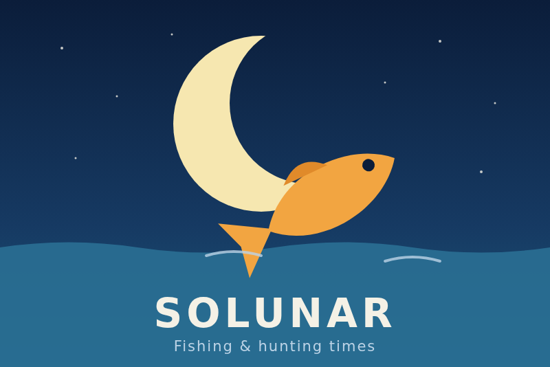

# Gladys Solunar

[Gladys Assistant](https://gladysassistant.com) external integration giving the **solunar periods**
for fishing and hunting (John Alden Knight's theory), computed locally from the position of the Moon
and the Sun: no account, no key, no internet access.



## What it does

- **One device per place**: each located house of Gladys and up to three fishing spots typed in the
  configuration. Features: period in progress (none, major, minor), period active, next period and
  minutes before it, day rating 0 to 4, moon phase and illumination.
- **Major periods** (two hours) centred on the Moon's upper and lower transits, **minor periods**
  (one hour) centred on moonrise and moonset, flagged when they meet a sunrise or a sunset.
- A **dashboard widget** (the periods of the day at a place), a **scene trigger** (a period starts,
  filtered by place, kind and rating) and a **scene action** (the day of a place, today or
  tomorrow).

It does not cover the moon itself (phase widget, lunar events): see
[gladys-moon-phase](https://github.com/William-De71/gladys-moon-phase).

User documentation: [English](docs/en.md) · [Français](docs/fr.md) · [Deutsch](docs/de.md) ·
[Español](docs/es.md).

## Requirements

- Gladys Assistant 5.1.0 or later.
- A house located in Gladys (Settings → Houses), or the coordinates of a fishing spot.

## Installation

In Gladys: **Integrations → Install from GitHub**, address `https://github.com/guim31/gladys-solunar`.
Save the configuration, then create the devices in the **Discover** tab.

## Limits

- The solunar theory is an anglers' tradition, not a scientific forecast.
- The day rating is this integration's own (phase and sun coincidences, see the documentation): other
  tables use other scales.
- Times are shown in the time zone of Gladys, even for a spot in another time zone.
- Beyond the polar circles, when the Moon neither rises nor sets, only the major periods remain.

## Accuracy

The tests compare the computation with tables recorded from the
[US Naval Observatory](https://aa.usno.navy.mil/data/RS_OneDay) for Toulouse, Lake Simcoe (Ontario)
and Tromsø (Norway, polar night and midnight sun) on three dates, and with a day of
[solunarforecast.com](https://solunarforecast.com): moonrise, moonset, transits, sunrise and sunset
agree within two minutes (tolerance of the tests: three).

## Development

```bash
npm ci
npm run format:check && npm run lint && npm test
npx -y github:GladysAssistant/integration-store --skip-image-check .
```

The tests run against the SDK's fake Gladys with a manual clock: they never touch the network. See
`CLAUDE.md` for the architecture and the rules of the repository. Releases go through the Release
workflow (Actions → Release).

## Credits

- Theory: John Alden Knight, _Moon Up, Moon Down_ (1942) and the solunar tables (1926).
- Astronomy: [astronomy-engine](https://github.com/cosinekitty/astronomy) by Don Cross (MIT).
- Reference tables: US Naval Observatory (public domain) and solunarforecast.com.
- Built on the official
  [integration template](https://github.com/GladysAssistant/integration-template-js) and
  [SDK](https://github.com/GladysAssistant/integration-sdk-js) of Gladys Assistant.

Not affiliated with any solunar table publisher.

## License

[Apache-2.0](LICENSE)
